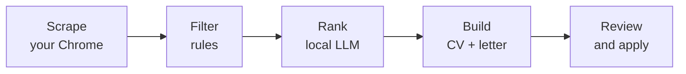

# RoleRadar

A local-first job search pipeline. RoleRadar collects job ads from LinkedIn
in your own browser, filters them with rules, ranks the rest with a local LLM,
and writes a tailored CV and cover letter for the best matches. You review
every document and apply yourself.



**Design principles**

- **Cheap work first.** Rules and LinkedIn's own filters remove most ads
  before any model runs; a free local model ranks the rest; the expensive
  writer only sees the shortlist.
- **Runs on your machine.** The API listens on `127.0.0.1` only. Your data
  stays in one SQLite file on your computer.
- **One program, many people.** Every rule (languages, years, locations,
  target roles) lives in each person's own profile, not in global settings.
- **Honest documents.** CVs only contain facts from your profile, and a human
  always applies.

## Status

| Stage | Part | Status |
| --- | --- | --- |
| 1 | Profiles, database, FastAPI server | Done |
| 2 | Rule pre-filter (years, languages, seniority) | Planned |
| 3 | Local LLM ranker (Ollama) | Planned |
| 4 | Chrome extension (LinkedIn) | Planned |
| 5 | Live check and CV / cover-letter builder | Planned |
| 6 | Dashboard and review page | Planned |
| 7 | Setup script and multi-profile switch | Planned |

Each stage has a write-up in [`docs/`](docs/) explaining how it works and why.

## Quick start

Requires Python 3.11+.

```bash
git clone https://github.com/omartaha7507/roleradar.git
cd roleradar
./start.sh          # Windows: start.bat
```

Open <http://127.0.0.1:8765/docs> to try the API. Create your profile by
copying `profiles/example/` to `profiles/<your-name>/` and editing it (see
[`profiles/README.md`](profiles/README.md)).

## Development

```bash
python -m venv .venv && source .venv/bin/activate
pip install -r requirements-dev.txt
pytest
```

## Project layout

```
roleradar/
  api/          FastAPI app, request/response schemas, routes
  db.py         SQLite connection and migrations
  keys.py       duplicate and re-post detection
  profiles.py   profile loading and validation
  searches.py   advice on saved search URLs
  store.py      reading and writing jobs, searches, events
profiles/
  example/      a sample profile; your own profiles are gitignored
docs/           one explanation per stage
tests/
```

## License

MIT
