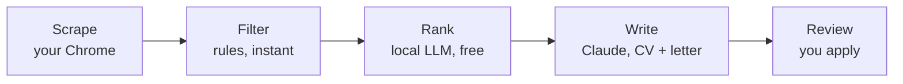

# RoleRadar

A local-first job search pipeline. RoleRadar collects job ads from LinkedIn in
your own browser, removes the obvious mismatches with rules, ranks the rest
with a local AI model, and writes a tailored CV and cover letter for the best
matches. You review every document and apply yourself.



## Why it is built this way

- **Cheap work first, expensive work last.** LinkedIn's own filters and a rule
  layer remove most ads before any model runs. A free local model (Ollama)
  ranks the rest. Claude only writes for the shortlist.
- **Honest documents.** CVs are written only from facts in your profile files.
  Every employer, school and project in the output is checked against them;
  anything invented is rejected and rewritten.
- **Runs on your machine.** The server listens on `127.0.0.1` only, data
  lives in one SQLite file, and your profile folder never reaches git.
- **One program, many people.** Every rule (languages, years, locations,
  target roles) lives in each person's profile, so friends in Berlin and
  Cairo can use the same install with different rules.
- **Every decision is explainable.** A dropped job shows the sentence that
  caused it; a ranked job shows how its score was made.

## What you need

| Tool | What it does here | Get it |
| --- | --- | --- |
| Python 3.11+ | Runs RoleRadar | [python.org](https://www.python.org/downloads/) (tick "Add to PATH") |
| Google Chrome | Scraping (with the extension) and making PDFs | [google.com/chrome](https://www.google.com/chrome/) |
| Ollama | Runs the ranking model locally, free | [ollama.com](https://ollama.com) |
| Claude Code | Writes the CVs and cover letters (needs a Claude subscription) | [Claude Code docs](https://docs.claude.com/en/docs/claude-code/overview) |

A laptop with 16 GB RAM is enough. Ranking runs on the CPU, so expect about a
minute per job with `llama3.1:8b`; `llama3.2` is faster and less careful.

## Setup (Windows)

```powershell
git clone https://github.com/omartaha7507/roleradar.git
cd roleradar
.\setup.bat
```

`setup.bat` installs the Python packages, offers to install Ollama and Claude
Code, downloads the model, creates your profile, and prints a checklist. Then:

1. **Fill in your profile** in `profiles/<your-name>/` (see below).
2. **Load the Chrome extension:** open `chrome://extensions`, turn on
   *Developer mode*, click *Load unpacked*, choose the `extension` folder.
3. **Sign in to Claude Code once:** open a terminal, type `claude`, sign in.
4. **Start:** double-click `start.bat`. The dashboard opens at
   <http://127.0.0.1:8787>.

On macOS or Linux, use `./start.sh` and install Ollama and Claude Code yourself.

## Your profile

`python -m roleradar new-profile <name>` copies `profiles/example/` to
`profiles/<name>/`. Edit the three files:

| File | What goes in it |
| --- | --- |
| `profile.yaml` | The rules: language levels, your years of experience and the limit, target roles, out-of-lane areas, locations and their bonuses |
| `identity.md` | Contact details, jobs, education and skills, exactly as they may appear on a CV |
| `projects.md` | One section per project: link, stack, what it proves, which roles it suits, facts and numbers |

Only facts written in these files can appear in a generated CV.

## Daily use

1. **Save searches.** Open a LinkedIn job search in Chrome, click the
   RoleRadar icon, *Save this LinkedIn search*. RoleRadar adds the "past week"
   and "entry level" filters if they are missing.
2. **Scrape.** Press *Scrape LinkedIn* on the dashboard. Within a minute a
   LinkedIn tab opens and works through your searches; leave it in front until
   it closes. New jobs are filtered by the rules as they arrive.
3. **Rank.** Press *Rank waiting jobs*. You can keep using the dashboard;
   progress shows live, and *Stop* finishes the current job and stops.
4. **Write.** Press *Write applications* for the best N, or tick jobs in the
   *Ranked* tab and write exactly those. Postings that closed are skipped.
5. **Review and apply.** In *To review*, open the CV, letter and posting,
   apply on the company's site, then press *Applied* (or *Skip*).

Applied jobs are remembered for good: if the role is re-posted later,
RoleRadar recognises it and drops it.

## Settings

Copy `settings.example.env` to `settings.env` (setup does this) and edit:

| Setting | Default | Meaning |
| --- | --- | --- |
| `ROLERADAR_OLLAMA_MODEL` | `llama3.1:8b` | Ranking model, any name from `ollama list` |
| `ROLERADAR_OLLAMA_TIMEOUT` | `300` | Seconds per job before giving up on it |
| `ROLERADAR_CLAUDE_MODEL` | `sonnet` | Model Claude Code uses for writing |
| `ROLERADAR_PORT` | `8787` | Dashboard port |
| `ROLERADAR_CHROME` | found automatically | Path to Chrome or Edge, for PDFs |

## Troubleshooting

| You see | Do this |
| --- | --- |
| "Port 8787 is already in use" | RoleRadar is already open in another window, or set another `ROLERADAR_PORT` |
| Setup: Chrome extension "Never seen" | Load the extension (above) and keep Chrome open; it checks in every minute |
| Scrape says you are signed out | Sign in to LinkedIn in Chrome, then scrape again |
| Ranking: "Ollama is not running" | Open the Ollama app |
| Ranking is slow | Use `llama3.2` in `settings.env`, or rank fewer jobs: tighten your LinkedIn searches |
| Build: "Claude Code was not found" or "not signed in" | Install it, then run `claude` once in a terminal and sign in |
| CVs only as HTML | Install Chrome, or set `ROLERADAR_CHROME` in `settings.env` |

`python -m roleradar check` prints the same setup checklist in the terminal.

## How it works

[`docs/HOW-IT-WORKS.md`](docs/HOW-IT-WORKS.md) explains the whole system step
by step in plain language: what each part does, how a job moves through it,
and why each design choice was made. [`docs/rule-filter.md`](docs/rule-filter.md)
goes deeper into the rules.

```
roleradar/
  api/            FastAPI app: routes for jobs, searches, pipeline, scraping
  static/         the dashboard (HTML, CSS, JavaScript)
  db.py           SQLite connection and versioned migrations
  keys.py         duplicate and re-post detection
  rules.py        stage 2: the rule filter
  filtering.py    runs the rule filter over stored jobs
  ollama.py       small client for the local model
  ranker.py       stage 3: AI ranking, caching and scoring
  scraping.py     stage 4: hand-over between dashboard and extension
  livecheck.py    is the posting still open?
  builder.py      stage 5: Claude writes, RoleRadar checks the facts
  documents.py    CV and letter format, fact checks, layout
  pdf.py          PDFs with the installed Chrome
  workers.py      background tasks with stop
  runs.py         progress tracking
  checks.py       the setup checklist
extension/        Chrome extension (Manifest V3)
profiles/example/ sample profile; your own profiles are gitignored
tests/            pytest suite
```

## Development

```bash
python -m venv .venv
.venv/bin/pip install -r requirements-dev.txt   # Windows: .venv\Scripts\pip
.venv/bin/python -m pytest
```

The tests need no AI and no internet: Ollama, Claude Code and job sites are
replaced by small fakes. If Playwright and its Chromium are installed, the
extension's scraper is also tested in a real browser against fake LinkedIn
pages.

## License

MIT
