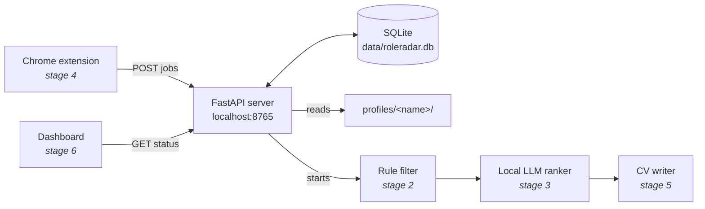

# Stage 1: Foundation

What this stage builds: the folders, the profile format, the database and the
local API server. Nothing scrapes or ranks yet, but every later part plugs
into what is here.

## The big picture



The server is the hub. Everything else talks to it over HTTP on
`localhost`, which means "this computer only".

## Files in this stage

| File | Job |
| --- | --- |
| `roleradar/settings.py` | Where data and profiles live, which port to use |
| `roleradar/profiles.py` | Loads and checks `profiles/<name>/profile.yaml` |
| `roleradar/db.py` | Opens the SQLite file and creates or upgrades its tables |
| `roleradar/keys.py` | Decides when two ads are the same job |
| `roleradar/searches.py` | Gives advice on saved LinkedIn search URLs |
| `roleradar/store.py` | All reading and writing of jobs, searches and events |
| `roleradar/api/` | The FastAPI app: request shapes, dependencies, routes |
| `tests/` | 36 automated tests for all of the above |

## 1. Profiles: rules per person

Each person has a folder under `profiles/`. The important file is
`profile.yaml`, which holds the rules the filter and ranker will use:

```yaml
languages:
  English: C1
  German: B1          # a job asking for B2+ German will be dropped
experience:
  years: 1
  drop_at_years: 3    # "3+ years required" will be dropped
```

**Why per person, not one global config?** A friend in Cairo needs no German
rule and wants Cairo first; you want Berlin first and a German limit. If the
rules live in the code or in one settings file, the program only works for
one person. With rules per profile, one program serves everyone.

**Why Pydantic checks the file.** `ProfileConfig` in `profiles.py` describes
exactly which keys are allowed and what values they take. A typo like
`drop_at_yaers`, or `German: fluent` instead of a real level, fails loudly
with the exact line, instead of silently being ignored and letting wrong jobs
through for weeks.

**Why names are strict** (`^[a-z0-9][a-z0-9_-]{0,39}$`). The profile name
becomes part of a file path. Without a check, a URL like
`/api/profiles/../../secret/jobs` could make the server read files outside the
profiles folder. This is called *path traversal*, a classic security bug.

## 2. The database: one SQLite file

Four tables, every one with a `profile` column:

| Table | One row per |
| --- | --- |
| `searches` | Saved search URL, with a stage (1 = first round) and page count |
| `jobs` | Job ad, with its status: new, passed, dropped, ranked, built, applied, skipped, closed |
| `runs` | Run of a step (scrape, filter, rank, build), with real progress: `done` of `total` |
| `events` | Line in the activity log |

**Why SQLite instead of JSON files.** With many JSON files, two programs
writing at once can corrupt a file or crash on Windows with "access denied".
A database handles that for you. WAL mode (`PRAGMA journal_mode = WAL`) lets
the dashboard read while the ranker writes.

**Transactions.** `store.ingest_jobs` wraps a whole batch in
`with transaction(conn):`. If job 37 of 50 is broken, none of the 50 are
saved, so the database is never left half-updated. The test
`test_failed_batch_writes_nothing` proves it.

**Migrations.** The tables are created by the scripts in `db.MIGRATIONS`.
SQLite stores the current version number in `PRAGMA user_version`; on every
start, `migrate()` runs only the scripts that are newer. When a later stage
needs a new table, we add a script instead of asking you to delete your
database.

## 3. Same job or not? (`keys.py`)

Two problems, two keys:

- **`url_key`: the same ad scraped twice.** LinkedIn shows one job under many
  URLs (`/jobs/view/4012345678`, `?currentJobId=4012345678`, with tracking
  junk). They all become `linkedin:4012345678`. The second time, the job is
  *refreshed*, not duplicated.
- **`role_key`: the same role re-posted under a new ad.** Companies re-post
  roles. `Acme GmbH` + `Junior AI Engineer (m/w/d)` and `ACME` +
  `Junior AI Engineer` both become `acme|junior ai engineer`. A re-post is
  stored but marked `dropped`, with the reason, and if you already applied to
  the original the reason says so.

German job titles almost always carry a gender marker (`m/w/d`, `f/m/x`,
`all genders`); stripping them is what makes re-posts match.

## 4. The API (`roleradar/api/`)

Start the server and open <http://127.0.0.1:8765/docs>: FastAPI builds that
page from the code, and every endpoint can be tried from it.

| Endpoint | What it does |
| --- | --- |
| `GET /api/health` | Is the server up, which database version |
| `GET /api/profiles` | All profiles, including broken ones with their error |
| `GET /api/profiles/{name}` | One profile's rules |
| `POST /api/profiles/{name}/jobs` | Add scraped jobs (used by the extension) |
| `GET /api/profiles/{name}/jobs` | List jobs; filter by `status`, search with `q` |
| `GET /api/profiles/{name}/jobs/{id}` | One job with its full description |
| `GET/POST /api/profiles/{name}/searches` | List or save searches |
| `PATCH/DELETE /api/profiles/{name}/searches/{id}` | Change or remove a search |
| `GET /api/profiles/{name}/summary` | Counts per status, latest runs |
| `GET /api/profiles/{name}/events` | Activity log |

Three FastAPI ideas do most of the work:

**Schemas** (`api/schemas.py`). Each request and response is a Pydantic
class. `pages: int = Field(ge=1, le=3)` means FastAPI itself rejects
`pages: 7` with a 422 error that names the field. No `if` checks in the
routes.

**Dependencies** (`api/deps.py`). A route that asks for `conn: Conn` gets a
database connection, opened before and closed after the request. A route that
asks for `profile: CurrentProfile` gets the loaded profile, or the caller gets
404 (no such profile) or 422 (profile.yaml has a problem) before the route
runs. Look at how short `routes_jobs.py` is because of this.

**App factory** (`api/app.py`). `create_app(settings)` builds a new app each
time. The tests use it to start an app on a temporary folder, so running the
tests never touches your real data.

### Search advice: filtering before downloading

When you save a LinkedIn search, the response includes `hints` and a
`suggested_url`:

```json
"hints": [
  "No 'date posted' filter: older ads are often closed by the time you apply. Suggested: past week (f_TPR=r604800).",
  "No experience filter: senior roles will flood the pool. Suggested: entry level + associate (f_E=2,3)."
],
"suggested_url": "https://www.linkedin.com/jobs/search/?keywords=ai+engineer&location=Berlin&f_TPR=r604800&f_E=2,3"
```

The cheapest way to drop a job is for LinkedIn never to show it. Every job
filtered out here is one the ranker never has to read.

## Try it yourself

```powershell
cd roleradar
.\start.bat                        # first run installs packages, then starts
```

Then open <http://127.0.0.1:8765/docs> and, using the `example` profile:

1. `POST /api/profiles/example/searches` with
   `{"label": "AI Berlin", "url": "https://www.linkedin.com/jobs/search/?keywords=ai%20engineer&location=Berlin"}`.
   Read the hints that come back.
2. `POST /api/profiles/example/jobs` with two jobs: the same title at
   `Acme GmbH` and `ACME`, one with `(m/w/d)`. The second comes back as a
   re-post.
3. `GET /api/profiles/example/jobs` to see both, one `dropped` with its reason.

To run the tests (from inside the `roleradar` folder):

```powershell
.\.venv\Scripts\python.exe -m pip install -r requirements-dev.txt
.\.venv\Scripts\python.exe -m pytest
```

## Questions worth being able to answer

- *Why does the server listen on 127.0.0.1 and not 0.0.0.0?* 127.0.0.1 only
  accepts connections from the same computer; 0.0.0.0 would expose your job
  data to everyone on the same Wi-Fi.
- *Why a new database connection per request?* FastAPI runs normal routes in
  a pool of threads, and a SQLite connection must not be shared between
  threads.
- *Why `BEGIN IMMEDIATE`?* It takes the write lock at the start of the
  transaction, so two writers queue up cleanly instead of failing halfway.
- *What happens if I edit profile.yaml while the server runs?* The profile is
  read again on every request, so the change applies straight away, without a
  restart.
