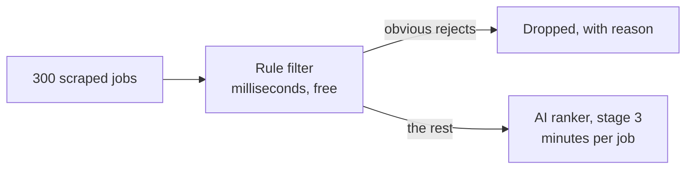

# The rule filter in detail

**In one sentence:** before any AI reads a job, simple rules throw out the
obvious rejects ("5+ years", "German C1", "Head of Data"), each with the
sentence that proves it.

## Why this stage exists

Running a local AI model on a laptop takes minutes per job. Most scraped jobs
are obviously wrong for a junior, and you don't need AI to see that an ad
says "at least 5 years of experience". So the order is:



This is a standard pattern in production AI systems: **cheap checks first,
expensive model last.** Every job the rules remove is AI time saved.

## The two promises the filter keeps

1. **It only drops on a clear, stated requirement.** "Experience is a plus"
   or "German would be nice" never drops a job. Those become *notes* that
   the AI weighs later. A filter that throws away good jobs is worse than
   one that lets a few bad ones through.
2. **Every decision shows its evidence.** A dropped job stores the exact
   sentence from the ad, so you can always check the filter's work.

## The files

| File | Job |
| --- | --- |
| `roleradar/rules.py` | The rules. Text and profile in, decision out. No database. |
| `roleradar/filtering.py` | Runs the rules over stored jobs, records progress |
| `roleradar/db.py` | Migration 2 adds `filter_result` and `filtered_at` to jobs |
| `roleradar/api/routes_jobs.py` | `POST /filter` and `POST /filter/test` |
| `tests/test_rules.py` | 54 cases from real-style ads in English and German |

`rules.py` deliberately knows nothing about the database or the web. It is
a *pure function*: the same ad and profile always give the same answer. That
makes it instant to run and easy to test with hundreds of examples.

## How each rule works

### Rule 1: years of experience

The tool here is the **regular expression** (regex): a pattern that
describes text. A simplified version of the pattern:

```
(\d+) \+? years of ... experience
```

reads as: *a number, maybe a plus sign, the word "years", up to a few words,
then "experience"*. It matches "5+ years of professional experience in ML".

The real patterns in `rules.py` cover the ways ads actually say it:

| Ad says | Found |
| --- | --- |
| 5+ years of professional experience | 5 |
| 3-5 years' experience | 3 (in a range, the lower number is the bar) |
| two years of industry experience | 2 (number words too) |
| Mindestens 3 Jahre Berufserfahrung | 3 (German) |
| Berufserfahrung von mindestens drei Jahren | 3 (German, reversed order) |

Then the decision, using your `profile.yaml`:

- 3 or more years (your `drop_at_years`) and **not** softened → **drop**
- Softened by "ideally", "preferred", "von Vorteil"… → **note only**
- More than your own years but below the limit → **note** ("Asks for 2 years")

**The traps**, which matter as much as the hits:

| Sentence | Why it is ignored |
| --- | --- |
| "**We** have over 20 years of experience in retail" | About the company, not you. Sentences with "we / our / wir / unser / since / seit" before the number are skipped |
| "You will gain experience across the ML lifecycle" | No number |
| "Python 3 and experience with Docker" | "3" isn't followed by "years" |

### Rule 2: languages

Two parts: find the **language**, then find the **level** closest to it in
the same sentence.

Levels come as CEFR codes (B2, C1) or as words, which the filter translates:

| Word in the ad | Level |
| --- | --- |
| native, Muttersprache | native |
| fluent, fließend, verhandlungssicher, **sehr gute**, excellent | C1 |
| good, **gute**, solid, strong | B2 |
| intermediate, conversational | B1 |
| basic, Grundkenntnisse | A2 |

A detail worth knowing: "sehr gute" contains "gute". Without care, the filter
would read "sehr gute Deutschkenntnisse" (very good, so C1) as just "gute"
(B2). So when two matches overlap, the longer phrase wins.

Then: required level above yours and not softened → **drop**. Example with
your B1 German: "Gute Deutschkenntnisse" (B2) drops; "German B1" passes;
"German is a plus" passes.

**The ad's own language.** An ad written entirely in German usually means a
job done in German. The filter counts common German words ("und", "wir",
"für") against common English ones ("and", "we", "for"). Above 70% German
and your German below B2 means drop. The 70% line is chosen so that an
English ad with a German legal footer ("Wir freuen uns auf deine Bewerbung")
stays English. A lower line would wrongly drop those English ads.

### Rule 3: seniority in the title

Words from your `seniority_words` (Staff, Principal, Lead, Head of, Director,
Architect) in the title mean drop, **unless** the ad mentions juniors,
graduates, Berufseinsteiger or trainees. "Senior" alone is not on the list by
default: some "Senior" roles are open to strong juniors, so the AI decides.

Whole words only: "Leading AI Engineer" is not "Lead".

### Rules 4 and 5: lane and location

Titles containing anything on your `out_of_lane` list (Sales, Recruiter…) are
dropped; "Salesforce Developer" is not, because whole words only. Locations
on your `exclude` list are dropped, as are remote jobs if `remote_ok: false`.

## How it runs

New jobs are filtered **the moment they arrive**: the ingest endpoint stores
them, then calls the filter. The answer now says how many passed:

```json
{"inserted": 25, "updated": 0, "reposts": 1, "passed": 9, "dropped": 15}
```

`filtering.py` works through jobs in batches of 50, updating the `runs`
table after each batch. That is what lets the dashboard (stage 6) show real
progress, "150 of 300 checked", instead of guessing.

**Changed your profile?** `POST /api/profiles/{name}/filter?rerun=true`
re-checks every job the filter decided before. Re-posts and jobs already
ranked or applied to are left alone.

## The one thing worth trying

This endpoint is genuinely useful, not just a test: it checks **any job ad**
against your profile without saving anything.

1. Start RoleRadar and open <http://127.0.0.1:8787/docs>.
2. Open **POST /api/profiles/{name}/filter/test** → **Try it out**.
3. Name: your profile name. Body: a real LinkedIn ad you're unsure about:
   ```json
   {
     "title": "the job title",
     "description": "paste the whole ad text here"
   }
   ```
4. **Execute.** You'll see the decision, the reasons with the exact sentence,
   and notes.

If the filter gets a real ad wrong, that's valuable: send it to me and it
becomes a new test case.

## Check yourself

1. Why does "Ideally 5 years of experience" pass, but "5 years of experience
   required" drop?
2. An English ad ends with two German sentences of legal text. Why isn't it
   treated as a German ad?
3. Why is `rules.py` kept free of any database code?

## Interview answer (30 seconds)

> "Before the LLM, a deterministic rule layer removes clear mismatches:
> required years, language levels in English and German including CEFR
> codes and German phrases like *verhandlungssicher*, seniority titles and
> excluded locations. It only drops on firm requirements; soft ones become
> notes for the model. Every drop stores the evidence sentence, so the
> filter is auditable. It runs in milliseconds and cuts the jobs that reach
> the model, which on a laptop takes minutes per job."
